  <picture>
    <source media="(prefers-color-scheme: dark)" srcset="assets/dark/header.svg">
    
  </picture>

 

<picture>
  <source media="(prefers-color-scheme: dark)" srcset="assets/dark/s-about.svg">
  
</picture>

<picture>
  <source media="(prefers-color-scheme: dark)" srcset="assets/dark/terminal.svg">
  
</picture>

 

<picture>
  <source media="(prefers-color-scheme: dark)" srcset="assets/dark/s-stack.svg">
  
</picture>

<picture>
  <source media="(prefers-color-scheme: dark)" srcset="assets/dark/stack.svg">
  
</picture>

 

 

<picture>
  <source media="(prefers-color-scheme: dark)" srcset="assets/dark/s-contact.svg">
  
</picture>

  <a href="https://t.me/Seliwam"><picture><source media="(prefers-color-scheme: dark)" srcset="assets/dark/c-telegram.svg"></picture></a>
  &nbsp;
  <a href="https://www.linkedin.com/in/aiman-erkinbecov/"><picture><source media="(prefers-color-scheme: dark)" srcset="assets/dark/c-linkedin.svg"></picture></a>

 

<picture>
  <source media="(prefers-color-scheme: dark)" srcset="assets/dark/footer.svg">
  
</picture>
